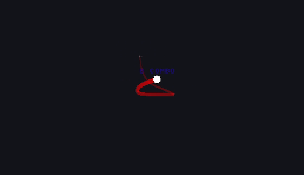
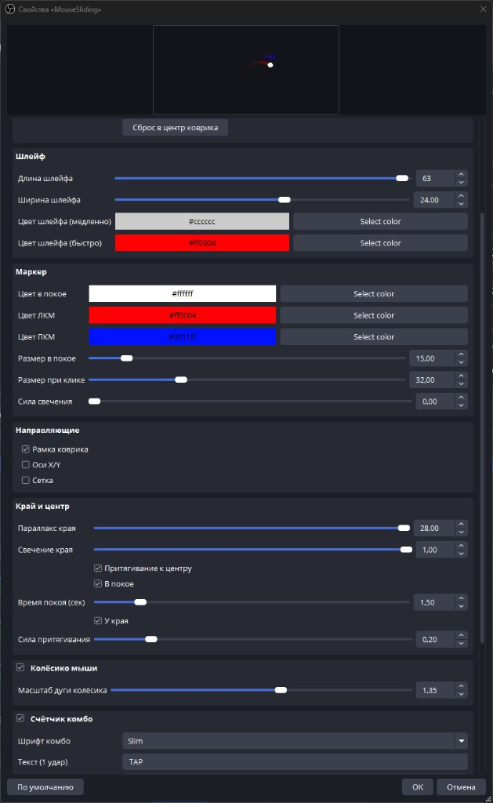

# Mouse Sliding (OBS Plugin)

[](https://github.com/Discrutans/mouse-sliding)
[](https://github.com/Discrutans/mouse-sliding/releases)
[](LICENSE)

Нативный плагин OBS Studio — оверлей **коврика мыши** для FPS-стримов: aim-pad, шлейф по скорости, клики ЛКМ/ПКМ, комбо-счётчик, дуга колёсика, parallax края и притягивание к центру.

<p align="center">
  
</p>

**Репозиторий:** https://github.com/Discrutans/mouse-sliding  
**Лицензия:** [GPL-3.0](LICENSE)

## Что это

Источник **Mouse Sliding** рисует коврик поверх сцены: маркер следует за raw mouse (в т.ч. в fullscreen), оставляет цветной шлейф, реагирует на клики и колёсико, показывает combo-текст. Удобно для aim training / FPS-стримов, когда нужно показать движение мыши зрителям.

## Скриншоты

| Демо шлейфа | Свойства в OBS |
|-------------|----------------|
|  |  |

## Download (без сборки)

Готовые сборки Windows x64: **[Releases](https://github.com/Discrutans/mouse-sliding/releases)**

1. Скачайте `mouse-sliding-windows-x64-v*-setup.exe`.
2. Запустите установщик и следуйте мастеру.
3. Перезапустите OBS → **Источники → + → Mouse Sliding**.

Установщик кладёт плагин в  
`C:\ProgramData\obs-studio\plugins\mouse-sliding\`.

> Если раньше копировали DLL вручную в `Program Files\obs-studio\obs-plugins\64bit\`, удалите ту копию — иначе OBS может загрузить старый плагин без ссылок и новых фич.

## Возможности

- Pad-режим: aim следует за raw mouse (работает в fullscreen)
- Шлейф по скорости (цвета slow/fast), клики ЛКМ/ПКМ, размер и glow маркера
- Combo TAP / `{n} COMBO` с шаблонами и шрифтами Arcade / Block / Slim
- Колёсико — орбитальная дуга с инерцией
- Край холста: parallax + soft glow; притягивание к центру (idle / edge)
- Направляющие: рамка коврика, оси, сетка
- Группы настроек, локали `en-US` / `ru-RU`
- Ссылки в свойствах: поддержка автора и GitHub

## Требования (использование)

- Windows 10/11 x64
- OBS Studio

## Сборка из исходников

Нужны Visual Studio 2022 (Desktop C++), CMake 3.28+, интернет при первой конфигурации.

```powershell
git clone https://github.com/Discrutans/mouse-sliding.git
cd mouse-sliding
.\build.ps1
```

DLL: `build_x64\rundir\RelWithDebInfo\mouse-sliding.dll`

Установщик Windows (Inno Setup 6):

```powershell
.\package-installer.ps1
```

Выход: `dist\mouse-sliding-windows-x64-v1.0.0-setup.exe`  
(после сборки нужна [Inno Setup 6](https://jrsoftware.org/isinfo.php); скрипт ставит её через winget при отсутствии).

## Структура

| Путь | Назначение |
|------|------------|
| `src/plugin-main.cpp` | Загрузка модуля |
| `src/mouse-sliding-source.cpp` | Физика + рендер |
| `data/` | locale + fonts |
| `docs/` | скриншоты для README |
| `installer/` | Inno Setup |
| `package-installer.ps1` | Сборка setup.exe |

Основано на [obs-plugintemplate](https://github.com/obsproject/obs-plugintemplate).

## Поддержать автора

https://dalink.to/discrutans
